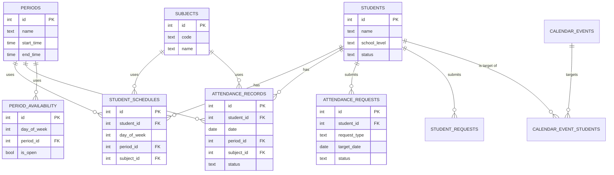

# RED 生徒管理・出欠管理システム データベース設計

対象: 全18テーブル(下の「テーブル一覧」を参照)
DB: Supabase (PostgreSQL)
DDL本体: [`schema.sql`](./schema.sql)(初期スナップショット)と、以降の変更を記録した `supabase/migrations/` を参照(完全なスキーマは「schema.sql → migrationsを日付順に適用」したもの。詳細は`schema.sql`冒頭)。このドキュメントは設計意図の説明に専念します

## テーブル一覧

| テーブル名 | 役割 |
|---|---|
| `periods` | コママスタ(時間割の枠) |
| `period_availability` | 曜日別のコマ受付可否(管理者が開閉を設定) |
| `subjects` | 科目マスタ |
| `students` | 生徒台帳 |
| `student_schedules` | 生徒ごとの定期スケジュール(曜日×コマ×科目) |
| `attendance_requests` | 欠席・振替の申請 |
| `attendance_records` | 出欠の実績記録(その日・そのコマの実際の状態) |
| `schools` | 学校マスタ(生徒の通学先を正規化) |
| `school_events` | 学校ごとの行事予定(生徒本人カレンダーに表示) |
| `calendar_closures` | 休講・特別開講の1日単位の例外設定 |
| `schedule_announcements` | 旧・塾からのお知らせ(日付紐付け)。新規登録は`calendar_events`(種類`juku`)へ移行済みで、既存データのみ引き続き表示 |
| `admin_todos` | 管理者用TODO(/dashboard) |
| `pricing_rules` | 学年区分ごとの1コマ単価(/my/pricing) |
| `textbooks` | 使用テキスト一覧(/materials, /my/textbooks) |
| `notices` | 生徒トップページの「お知らせ欄」(日付に紐付かない一般的な掲示) |
| `calendar_events` | 単発授業・先生の予定・塾のお知らせ/予定(`visibility`で表示範囲を制御) |
| `calendar_event_students` | `calendar_events`の対象生徒と、その授業での出欠 |
| `student_requests` | 欠席・振替以外の申請(テキスト購入・面談・コマ数変更・固定枠変更) |

> 各テーブルの列・制約・RLSポリシー・索引・トリガーは、`schema.sql`と`supabase/migrations/`を空のPostgreSQLに日付順で適用した結果と本番DBを全項目照合し、完全に一致することを確認済みです(2026-11-08。照合で見つかった記載漏れは`migrations/20261108000100_sync_schema_with_live.sql`で補完)。

## ER図

## 各テーブルの設計ポイント

### periods(コママスタ)
時間割の「枠」を管理するマスタ。①〜⑧の8コマ(15:00〜20:55、各40分)を`schema.sql`に初期データとして投入済み。

| カラム | 内容 |
|---|---|
| name | 表示名(①〜⑧) |
| start_time / end_time | 開始・終了時刻 |
| sort_order | 表示順 |

### period_availability(曜日別のコマ受付可否)
「その曜日・そのコマを受け付けるか」を管理するマスタ。生徒個別のスケジュール(`student_schedules`)とは別に、教室全体としての営業枠を管理者が設定できるようにするためのテーブル。

7曜日×8コマ=56行を全て明示的に投入し(行の有無ではなく`is_open`で判定)、初期値は以下の通り。

| 曜日 | 受付コマ |
|---|---|
| 日 | なし(終日クローズ) |
| 月〜金 | ④〜⑧ |
| 土 | ①〜⑥ |

管理者はこの表の`is_open`を更新することで、曜日ごとの受付コマを自由に変更できる。 `capacity`列で、そのコマの受付人数の上限を設定できる(NULL=上限なし)。開閉と上限は`/admin-calendar`で管理する。

### subjects(科目マスタ)

科目をマスタ化したもの。コード・表示名・並び順は運用に合わせて変更されている(経緯: `supabase/migrations/20260906000100_reorganize_subjects.sql`)。現在の内容はDBまたは`/students`の科目選択で確認してください。初期データは`schema.sql`に含まれ、その後の変更はmigrationsで反映されます。

| カラム | 内容 |
|---|---|
| code | 短縮コード |
| name | 表示名 |
| sort_order | 表示順 |

### students(生徒)
生徒台帳。`status`で在籍中/退会済みを区別し、一覧から退会者を自然に除外できるようにしています。

| カラム | 内容 |
|---|---|
| name / name_kana | 氏名・フリガナ |
| school_level / school_name / grade | 小中高区分・学校名・学年 |
| status | active(在籍中) / inactive(退会済み) |
| login_id | 生徒本人ログイン用ID(管理者が発行、任意の文字列) |
| auth_user_id | Supabase Authのユーザー(UUID)との紐付け。生徒ログインの実体はSupabase Authが持つ |
| birthdate | 生年月日 |

### 生徒本人ログインの仕組み
生徒は基本的にメールアドレスを持たない前提のため、Supabase Authは`<login_id>@students.internal`のような実在しないダミーメールで登録し、パスワードのみ管理者が発行・共有する。ログイン画面では生徒は`login_id`とパスワードだけを入力し、アプリ内部でダミーメールに変換してSupabase Authへ渡す。
ログイン後は`auth.uid()`を使ったRLSポリシー(下記)により、その生徒自身の行しか読めない。

### student_schedules(生徒別定期スケジュール)
「曜日・コマ・科目」の定期スケジュール。**月次のバッチ生成は行わず、画面表示のたびにこのテーブルから当日分を計算します。** 有効期間(`effective_from`〜`effective_until`。終了日が空=現在有効)を持ち、同じ生徒・同じ曜日・同じコマで有効期間が重なる行は、DB制約(`student_schedules_no_overlap`、`btree_gist`拡張を使用)により登録できません。スケジュールの変更方法は`src/lib/data/schedules.ts`の`replaceStudentSchedule`を参照。

**80分授業(小学5年生以上)の扱い**: 同じ曜日・同じ科目で2行(連続コマ)を登録することで表現する。例: 火曜80分授業なら(火・③・算数)と(火・④・算数)の2行。
有効な連続コマは(①②)(③④)(⑤⑥)(⑦⑧)の組み合わせのみで、奇数コマ単独(①③⑤⑦のみ)の登録は80分単位にならないためNG。この検証はDBスキーマではなくNext.js側の業務ロジック層で行う想定(**管理者操作の場合は警告表示のみで登録自体は許可**、という例外があるため)。

### attendance_requests(欠席・振替申請)
生徒・保護者からの欠席/振替申請を管理。承認フローは`status`(pending/approved/rejected)で管理します。

### attendance_records(出欠記録)
その日・そのコマの実際の記録。**レコードが存在しない組み合わせは「定期スケジュール通り・未確定」を意味します。** 欠席・振替・科目変更など個別の変更があった場合のみ、この表に1行作成・更新します。

| status | 意味 |
|---|---|
| present | 出席 |
| absent | 欠席 |
| late | 遅刻 |
| makeup | 振替(その授業を別の日に振り替えた。振替先は`makeup_date`/`makeup_period_id`) |
| no_show | 無断欠席 |

`makeup_attendance_status`は、振替先の授業そのものの出欠(元コマの`status`とは独立。振替授業で欠席しても再振替は行わない)。

### schools / school_events(学校マスタ・学校行事)
生徒の`school_name`を自由入力のままにせず、`schools`テーブルで正規化する。生徒登録・編集時に学校名を入力すると`findOrCreateSchoolByName()`が同名の行を探し、無ければ新規作成して`students.school_id`に紐付ける。`school_events`はその学校の行事予定で、生徒本人の月次カレンダー(`/my`)に自校の行事として表示される。

### calendar_closures / schedule_announcements(休講設定・お知らせ)
デフォルトでは日曜・月曜が休講(`isDefaultClosedWeekday`)という前提のうえで、`calendar_closures`に1日単位の例外(特別開講・追加休講)を`closure_date`をキーに登録できる。`schedule_announcements`は日付に紐づく旧・塾からのお知らせで、既存データは生徒側カレンダーに表示され続ける(新規の塾のお知らせ・予定は`calendar_events`の種類`juku`に登録する)。休講・特別開講・お知らせの登録と削除は、`/dashboard`(カレンダー全体)の「新規登録」「編集」から行う。

### admin_todos(管理者用TODO)
`/dashboard`で管理者が日付ごとに管理する簡易TODO。生徒側には公開しない。

### pricing_rules / textbooks(料金・テキスト)
`pricing_rules`は学年区分(`grade_label`)ごとの1コマ単価で、`/my/pricing`の料金シミュレーションの元データ。`textbooks`は科目・学年別の使用テキスト(`level`=小学生/中学生/高校生、`grade_label`、複数科目にまたがる教材は`subjects`配列)で、`/materials`(管理画面)で登録し`/my/textbooks`(生徒側)で閲覧する。

### notices(お知らせ欄)

生徒トップページ(`/my`)のカレンダー上部に、新しい順で表示する一般的な掲示。日付には紐付かない。管理者が`/dashboard`の「新規登録」→「お知らせ欄」から登録・削除する。

### calendar_events / calendar_event_students(単発授業・先生の予定・塾のお知らせ/予定)

`event_type`は`lesson`(単発授業)・`teacher`(先生の予定)・`juku`(塾のお知らせ/予定)。`visibility`で表示範囲を制御する(`admin_only`=管理者のみ / `selected`=選んだ生徒のみ / `all`=全員)。生徒はRLSにより自分に見える予定だけを読める。`calendar_event_students`は対象生徒と、その授業での出欠(`attendance_status`)を持つ。

### student_requests(その他の申請)

欠席・振替以外の申請(`request_type`: `textbook_purchase`=テキスト購入 / `interview`=面談 / `lesson_count_change`=コマ数変更 / `fixed_slot_change`=固定枠変更)。内容は`details`(JSON)に入る。生徒は自分の分だけ参照・登録でき、管理者が`/requests`で処理する。

## 出欠データの表示ロジック(重要)

1. 管理画面で日付を選択すると、その日の曜日をもとに`student_schedules`を検索し、コマごとの「本来来るはずの生徒一覧」を算出する(バッチ生成なし)。
2. 同じ日付・コマ・生徒の組み合わせで`attendance_records`にレコードがあれば、そちらを優先して表示する(ステータス・科目の上書き)。
3. 定期スケジュールにない生徒をその日そのコマに追加したい場合(振替出席の受け入れなど)は、`attendance_records`に新規行を作成する。

## 確認・検討事項

1. ~~`attendance_requests`が承認された際、`attendance_records`を自動更新するか、手動で確認・入力するか未確定です。~~ → 解決済み。`approveRequest()`が対象コマを特定できる場合は自動反映し、特定できない場合のみ管理者に手動反映を促す(2026-08-25確認)。
2. `students`に他に必要な項目(保護者連絡先など)があれば追加します(学校名は追加済み)。
3. 80分授業の連続コマ検証(上記)はDBの制約ではなくアプリ側で実装する前提です。DB側での制約化(トリガー等)が必要であれば別途相談してください。
4. 【運用ルール】スキーマ変更は`supabase/migrations/`に新しいファイルとして追加する(適用済みのファイルは書き換えない)。`schema.sql`は初期スナップショットとして扱い、変更しない。あわせて、このドキュメントの該当記述を更新するところまでを完了とする(2026-08-25と2026-11-08に更新漏れが見つかり、解消した)。

## 決定済み事項

- **RLS**: 管理画面(Next.jsサーバー側)はservice role keyを使うためRLSの影響を受けない。生徒本人ログイン(Supabase Auth・anon key経由)には、画面表示に必要な範囲だけを読める(一部は自分の分を登録できる)ポリシーを設定している。ポリシーが1つも無いのは`admin_todos`と`period_availability`のみで、service roleからしか読み書きできない。anonロール(未ログイン)には一切のアクセス権を与えていない。定義は`schema.sql`と`supabase/migrations/`を参照。
